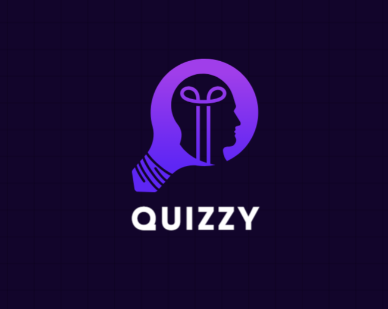
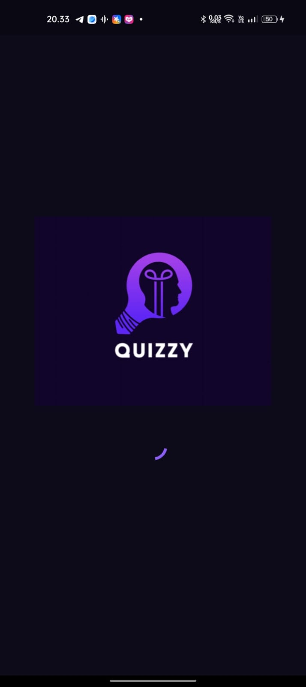
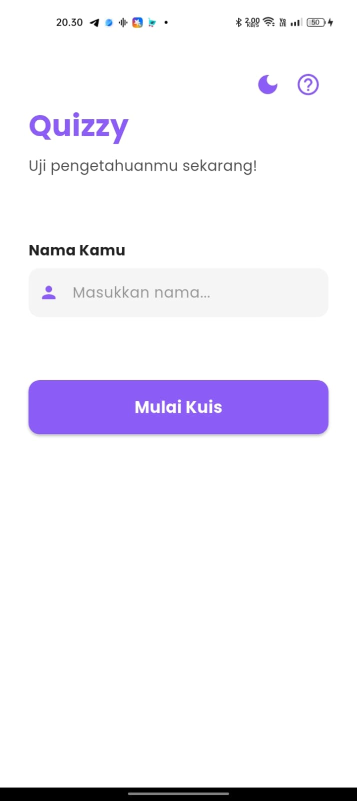
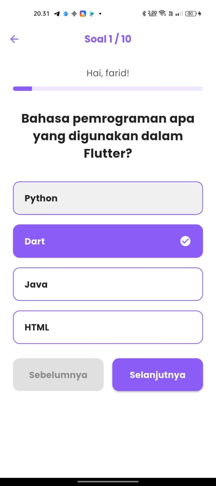
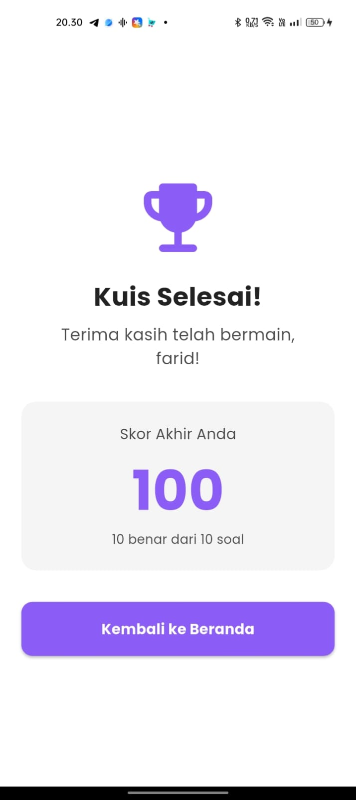
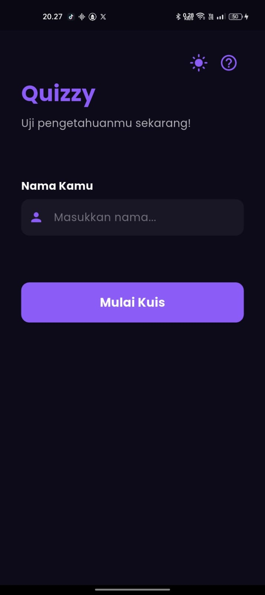
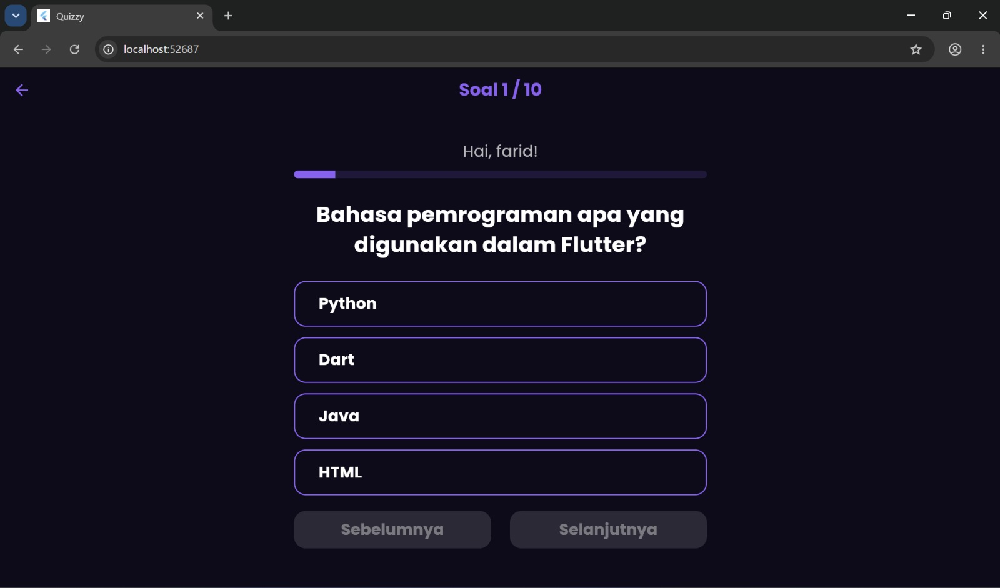

# 🧠 Quizzy — Aplikasi Kuis Pilihan Ganda

<p align="center">
  
</p>

---

## 👤 Identitas Mahasiswa

| Field    | Detail                   |
| -------- | ------------------------ |
| **Nama** | Farid Sani Ahdaputra     |
| **NIM**  | 24140117                 |
| **Lab**  | Lab 2 Pemrograman Mobile |

---

## 📱 Informasi Aplikasi

### Nama Aplikasi

**Quizzy**

### Deskripsi Singkat

Quizzy adalah aplikasi kuis pilihan ganda berbasis Flutter. Pengguna memasukkan nama,
menjawab 10 soal seputar dasar-dasar Flutter secara berurutan, lalu melihat skor akhir
beserta jumlah jawaban yang benar. Data soal bersifat lokal (dummy), sehingga aplikasi
tidak memakai database.

### Fitur-Fitur yang Tersedia

#### ✅ Fitur Wajib

| No  | Fitur                                | Keterangan                                                                                                          |
| --- | ------------------------------------ | ------------------------------------------------------------------------------------------------------------------- |
| 1   | **StatelessWidget & StatefulWidget** | `SplashScreen` dan `HomeScreen` (Stateful); `QuizScreen` dan `ResultScreen` (Stateless)                             |
| 2   | **Minimal 2 Halaman & Navigasi**     | Splash → Beranda → Kuis → Hasil → Beranda menggunakan `Navigator`                                                   |
| 3   | **Reusable Widget**                  | `CustomButton`, `OptionButton`, dan `ResponsiveCenter`, masing-masing di file terpisah                              |
| 4   | **Aset Gambar & Ikon**               | Logo (`assets/images/logo.png`) dan Material Icons                                                                  |
| 5   | **Font Kustom**                      | Poppins, didaftarkan di `pubspec.yaml`                                                                              |
| 6   | **Ukuran UI Dinamis**                | Helper `Responsive` (`wp`, `hp`, `sp`) menghitung ukuran dari layar, tanpa nilai hardcode                           |
| 7   | **State Management**                 | `QuizController` (`ChangeNotifier`) menyimpan progres, sehingga tidak hilang saat layar diputar atau pindah halaman |
| 8   | **Data Lokal / Dummy**               | 10 soal di `lib/data/quiz_data.dart`, tanpa database                                                                |
| 9   | **GitHub**                           | Pengembangan dicatat dengan commit per fitur                                                                        |

#### 🌟 Fitur Bonus

| No  | Fitur                            | Keterangan                                                                                        |
| --- | -------------------------------- | ------------------------------------------------------------------------------------------------- |
| 1   | **Dark Mode & Light Mode**       | Tema awal mengikuti sistem dan bisa diganti lewat tombol di beranda                               |
| 2   | **Adaptive & Responsive Design** | Lebar konten dibatasi 600 px dan ukuran dihitung dari layar, sehingga rapi di HP, tablet, dan web |

#### ✨ Fitur Tambahan

| Fitur           | Keterangan                                                               |
| --------------- | ------------------------------------------------------------------------ |
| Splash screen   | Logo ditampilkan 3 detik sebelum masuk ke beranda                        |
| Validasi nama   | Kuis tidak bisa dimulai jika nama masih kosong                           |
| Progress bar    | Menunjukkan posisi soal saat ini                                         |
| Navigasi soal   | Tombol Sebelumnya / Selanjutnya, dan jawaban bisa diubah sebelum selesai |
| Lanjutkan Kuis  | Kuis yang belum selesai bisa dilanjutkan dari beranda                    |
| Dialog petunjuk | Penjelasan cara bermain di beranda                                       |
| Halaman hasil   | Skor akhir dan jumlah jawaban benar                                      |

---

## 📸 Screenshot Aplikasi

|               Splash               |              Beranda              |              Kuis              |
| :--------------------------------: | :-------------------------------: | :----------------------------: |
|  |  |  |

|               Hasil               |              Dark Mode              |             Tablet / Web              |
| :-------------------------------: | :---------------------------------: | :-----------------------------------: |
|  |  |  |

---

## 🔗 Tautan

| Jenis                 | Link                                                                                                                 |
| --------------------- | -------------------------------------------------------------------------------------------------------------------- |
| 🎨 Mockup / Prototype | [Lihat mockup Quizzy](https://www.figma.com/design/JrqERcUUdYIzvHBFUxr7Jy/Untitled?node-id=0-1&t=MnzJxylRM87kTdTC-1) |

---

## 🗂️ Struktur Proyek

```
lib/
├── main.dart                          # Entry point, tema terang/gelap
├── controllers/quiz_controller.dart   # State management (ChangeNotifier)
├── data/quiz_data.dart                # Data soal
├── models/question_model.dart         # Model soal
├── screens/                           # splash, home, quiz, result
├── utils/responsive.dart              # Pembantu ukuran dinamis
└── widgets/                           # CustomButton, OptionButton, ResponsiveCenter
```

---

## 🙏 Credit Aset

- **Font:** Poppins (Indian Type Foundry) via Google Fonts, lisensi SIL Open Font License
- **Ikon:** Material Icons bawaan Flutter
- **Logo:** Dibuat sendiri

---

## 🛠️ Teknologi yang Digunakan

| Teknologi        | Keterangan                                             |
| ---------------- | ------------------------------------------------------ |
| Flutter          | Framework UI                                           |
| Dart             | SDK `^3.13.2` (sesuai `pubspec.yaml`)                  |
| State management | `ChangeNotifier` bawaan Flutter (tanpa paket tambahan) |
| Font             | Poppins                                                |

---

## 🚀 Cara Menjalankan Proyek

```bash
# 1. Clone repository
git clone https://github.com/FaridSaniAhdaputra/Quizzy.git

# 2. Masuk ke direktori proyek
cd Quizzy

# 3. Install dependencies
flutter pub get

# 4. Jalankan aplikasi
flutter run

# Atau jalankan di browser
flutter run -d chrome
```
